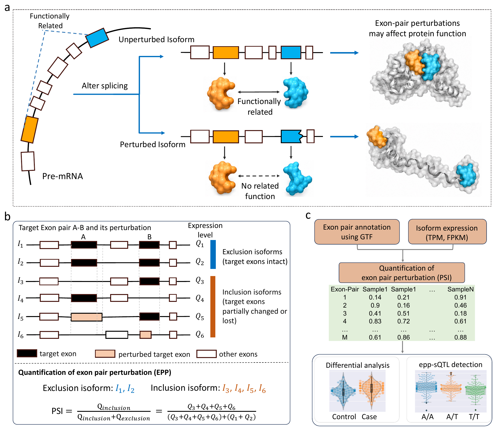

# PexTurb

## Description

PexTurb quantifies **exon-pair perturbation (EPP)** from transcript annotations and isoform expression levels. For each gene, it enumerates exon pairs across annotated isoforms in a GTF file. For a target exon pair, isoforms in which at least one target exon is elongated, shortened, or absent are defined as **inclusion isoforms**, whereas isoforms preserving both target exons are defined as **exclusion isoforms**.

EPP is quantified using percent spliced in (PSI):

$$
\mathrm{PSI} = \frac{Q_{\mathrm{inclusion}}}{Q_{\mathrm{inclusion}} + Q_{\mathrm{exclusion}}},
$$

where $Q_{\mathrm{inclusion}}$ and $Q_{\mathrm{exclusion}}$ are the summed expression levels of inclusion and exclusion isoforms, respectively. PSI therefore represents the fraction of exon-pair-associated expression contributed by isoforms with at least one perturbed target exon.

Applying this calculation across exon pairs and samples produces an **exon-pair-by-sample PSI matrix**. This matrix provides a quantitative representation of alternative splicing for differential EPP analysis and downstream applications such as EPP-based splicing quantitative trait locus (epp-sQTL) mapping.



**Figure 1. Overview of PexTurb.** **a**, Motivation for exon-pair-based splicing analysis. **b**, Definition of inclusion and exclusion isoforms and calculation of EPP PSI. **c**, Workflow from transcript annotation and isoform expression to a PSI matrix and downstream analyses. [View the original figure as a PDF](figures/figure1.pdf).

## 1. Installation

Create and activate a conda environment with the required Python packages:

```bash
conda create -n pexturb --override-channels -c conda-forge \
  python=3.10 numpy=1.23.3 scipy=1.9.1 statsmodels=0.13.2 -y
conda activate pexturb
```

If starting from FASTQ files, also install Salmon:

```bash
conda install --override-channels -c conda-forge -c bioconda \
  --strict-channel-priority salmon=1.4.0 -y
```

## 2. PexTurb input and output

PexTurb requires an **isoform expression matrix (A)** and a matching **GTF annotation (B)** to generate an exon-pair PSI matrix. A **sample group annotation** is additionally required by `pexturb_test.py` to compare control and case samples.

The workflow follows three steps:

1. `gtf_index.py` uses the expression matrix and GTF to generate an exon-pair index.
2. `calc_psi.py` uses the expression matrix and generated index to calculate PSI.
3. `pexturb_test.py` uses the PSI matrix and sample group annotation for differential testing.

### A: Isoform expression

A tab-separated matrix with a header. The first column contains transcript IDs, and each subsequent column contains TPM or FPKM values for one sample. Transcript IDs and sample IDs must be unique; expression values must be finite and nonnegative.

```text
transcript_id	sample_01	sample_02	sample_03
ENST00000336777	691.889740	436.688694	687.817398
ENST00000337502	291.386979	284.906979	264.778610
```

Transcript version suffixes, such as `.3` in `ENST00000336777.3`, are removed when matching expression-matrix transcript IDs to the GTF.

### B: GTF annotation

A GTF file describing the genes, transcripts, and exons in the reference used for isoform quantification. It must contain `gene`, `transcript`, and `exon` records with transcript IDs matching the expression matrix. The current parser supports chromosomes `1`–`22`, `X`, and `Y`, with or without the `chr` prefix.

`gtf_index.py` generates the exon-pair index from these two inputs. The index is an intermediate file created by the workflow.

### Sample group annotation for differential testing

`pexturb_test.py` requires a tab-separated file with two columns and **no header**: sample ID and group. Supply exactly two groups, with sample IDs matching columns in the PSI matrix.

```text
sample_01	control
sample_02	control
sample_26	case
sample_27	case
```

Group labels can be any two distinct names. The group appearing first is group 1, and `delta_psi = mean(PSI in group 1) − mean(PSI in group 2)`. Only the samples listed in this file are used for the differential test.

### PexTurb output

| Output file | Contents |
|---|---|
| Exon-pair index | Generated intermediate file linking exon-pair features to transcript rows in the expression matrix |
| PSI matrix | Exon-pair features as rows and samples as columns, preceded by feature and gene annotations |
| Differential result | Exon-pair identifiers, gene annotations, `delta_psi`, `pvalue`, and `fdr` |

Output filenames and column definitions are explained in Section 3.3.

## 3. Example usage

### 3.1 Example input data

The simulated example includes a **control group** with baseline isoform expression and a **case group** with simulated changes in isoform expression.

| Group label in the annotation file | Role | Samples |
|---|---|---|
| `groups0` | Control: baseline expression | `sample_01`–`sample_05` |
| `groups5` | Case: altered isoform expression | `sample_26`–`sample_30` |

Use the following three files from `example/data/`:

| Input | File | Structure |
|---|---|---|
| A: Isoform expression (`--tpm`) | `simulated_tpm.txt` | Transcript IDs in the first column; sample IDs in the header; TPM values in the remaining columns |
| B: GTF annotation (`--gtf`) | `simulated_annotation.gtf` | Gene, transcript, and exon annotations matching the expression matrix |
| Sample groups for differential testing (`--anno`) | `anno_group0_vs_group5.txt` | Two columns without a header: sample ID and group label |

The group file selects the control and case samples for the differential test.

### 3.2 Running PexTurb

From the repository root, users can run the following command to analyze the example isoform expression matrix. It generates the exon-pair index, calculates the PSI matrix, and performs differential analysis:

```bash
bash run_all.sh \
  --tpm example/data/simulated_tpm.txt \
  --gtf example/data/simulated_annotation.gtf \
  --anno example/data/anno_group0_vs_group5.txt \
  --outdir example/output \
  --min-group-cnt 1
```

The three output files are written to `example/output/`. The `--min-group-cnt` argument specifies the minimum number of non-missing PSI values required **in each group** for a feature to be tested; the default is `1`.

<details>
<summary>Run the individual steps or use the precomputed index</summary>

Create the output directory and generate the index:

```bash
mkdir -p example/output

python code_pexturb/gtf_index.py \
  --tpm example/data/simulated_tpm.txt \
  --gtf example/data/simulated_annotation.gtf \
  --index example/output/simulated_tpm_index.txt
```

Calculate the PSI matrix:

```bash
python code_pexturb/calc_psi.py \
  --tpm example/data/simulated_tpm.txt \
  --index example/output/simulated_tpm_index.txt \
  --psi example/output/simulated_tpm_psi.txt
```

To use the precomputed index, skip index generation and replace the `--index` path above with `example/data/simulated_index.txt`.

Perform the differential test:

```bash
python code_pexturb/pexturb_test.py \
  --psi example/output/simulated_tpm_psi.txt \
  --anno example/data/anno_group0_vs_group5.txt \
  --output example/output/simulated_tpm_pexturb.txt \
  --min_group_cnt 1
```

The standalone test uses `--min_group_cnt` with underscores; `run_all.sh` exposes this setting as `--min-group-cnt`.

</details>

<details>
<summary>Prepare an isoform expression matrix from your own FASTQ files</summary>

Build a Salmon index using a GENCODE transcript FASTA corresponding to your GTF:

```bash
bash 01_salmon/build_salmon_index.sh \
  gencode.transcripts.fa.gz \
  salmon_index
```

For a decoy-aware index, provide a FASTA containing both transcript and decoy sequences and pass the matching decoy-name list as the third argument:

```bash
bash 01_salmon/build_salmon_index.sh \
  gentrome.fa.gz \
  salmon_index \
  decoys.txt
```

Prepare `samples.tsv` with no header. Use three tab-separated columns for paired-end samples or two for single-end samples:

```text
sample_01	/path/sample_01_R1.fastq.gz	/path/sample_01_R2.fastq.gz
sample_02	/path/sample_02.fastq.gz
```

Quantify the samples and combine their `quant.sf` files:

```bash
bash 01_salmon/run_salmon.sh \
  --samples samples.tsv \
  --index salmon_index \
  --outdir salmon_output \
  --threads 8

python 01_salmon/build_tpm_matrix.py \
  --quant-root salmon_output \
  --output expression.txt
```

By default, a transcript is removed if its TPM is below 1 in at least 50% of the samples. Add `--keep-all` to the matrix-building command to retain all transcripts shared by the samples.

Then analyze your expression matrix with a matching GTF and two-group sample annotation:

```bash
bash run_all.sh \
  --tpm expression.txt \
  --gtf annotation.gtf \
  --anno sample_groups.tsv \
  --outdir results
```

</details>

### 3.3 Results interpretation

The example generates:

```text
example/output/
├── simulated_tpm_index.txt
├── simulated_tpm_psi.txt
└── simulated_tpm_pexturb.txt
```

#### Output file explanation

| File | Explanation |
|---|---|
| `simulated_tpm_index.txt` | Intermediate exon-pair index generated from the expression matrix and GTF |
| `simulated_tpm_psi.txt` | PSI matrix with feature identifiers, `gene_id`, and `gene_name` in the first three columns, followed by sample columns; undefined PSI values are written as `NA` |
| `simulated_tpm_pexturb.txt` | Control-versus-case differential results, with one row per tested exon-pair feature |

**The differential result file contains the following columns:**

| Column | Meaning |
|---|---|
| `chr:exon_up+exon_down` | Exon-pair coordinates; semicolons separate pairs represented by the same feature |
| `gene_id` | Gene identifier from the GTF |
| `gene_name` | Gene name from the GTF, or gene ID if no name is available |
| `delta_psi` | Mean PSI in group 1 minus mean PSI in group 2 |
| `pvalue` | Two-sided Welch t-test p-value after clipping PSI to [0.001, 0.999] and applying the logit transformation |
| `fdr` | Benjamini–Hochberg adjusted p-value across tested features |

Use `fdr < 0.05` to select significant features. Features with fewer non-missing values than `--min-group-cnt` in either group are excluded from testing.

**Current output convention.** The manuscript defines EPP PSI as the perturbed-isoform fraction, as shown in Description and Figure 1. The current `calc_psi.py` instead writes the retained-pair fraction, which is its complement: `EPP PSI = 1 − output PSI`. Consequently, a positive `delta_psi` in the current output indicates greater pair retention in group 1; the corresponding EPP change has the opposite sign. This distinction applies to interpreting effect direction.

## Repository Contents

```text
PexTurb/
├── README.md
├── run_all.sh                         # index → PSI → differential test
├── 01_salmon/
│   ├── build_salmon_index.sh           # build the Salmon index
│   ├── run_salmon.sh                   # quantify paired- or single-end samples
│   └── build_tpm_matrix.py             # merge quant.sf files into a TPM matrix
├── code_pexturb/
│   ├── gtf_index.py                    # generate exon-pair indices
│   ├── calc_psi.py                     # calculate the PSI matrix
│   └── pexturb_test.py                 # differential analysis and FDR correction
├── example/
│   ├── README.md
│   ├── prepare_subset_gtf.py           # helper for constructing the example GTF
│   ├── data/                          # example inputs and simulation truth
│   └── expected/                      # reference differential result
└── figures/
    ├── figure1.png                     # method overview displayed in this README
    └── figure1.pdf                     # original PDF extracted from the manuscript
```

## 4. Contact

- Shixian Wang: [234701007@csu.edu.cn](mailto:234701007@csu.edu.cn); [wsx202017455@gmail.com](mailto:wsx202017455@gmail.com)
- Hong-Dong Li: [hongdong@csu.edu.cn](mailto:hongdong@csu.edu.cn)
